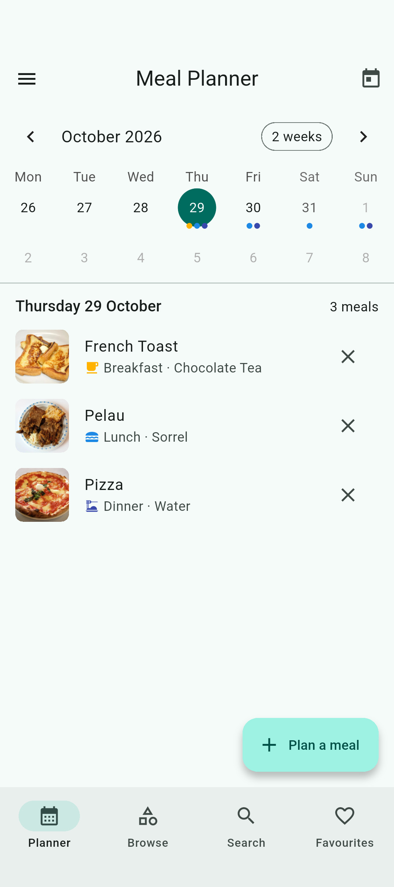
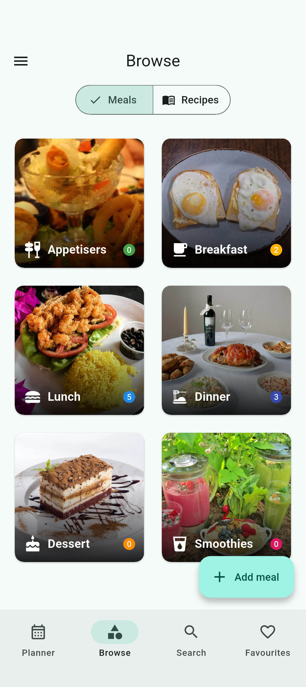
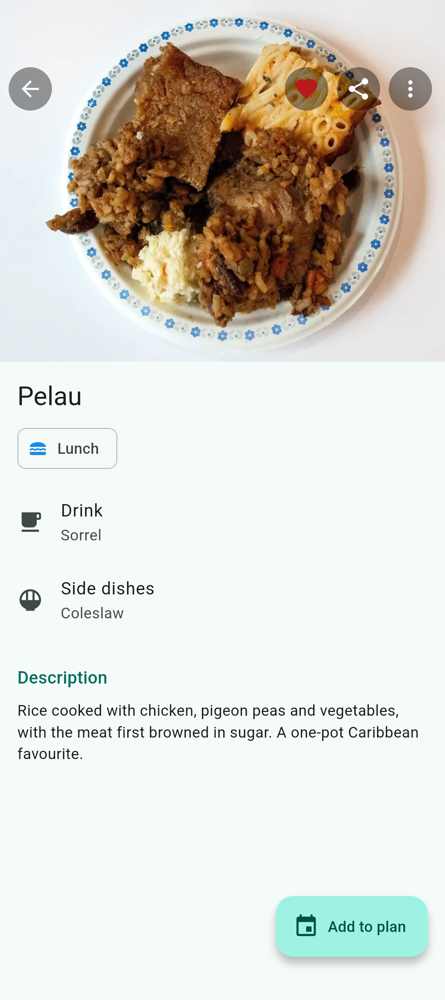
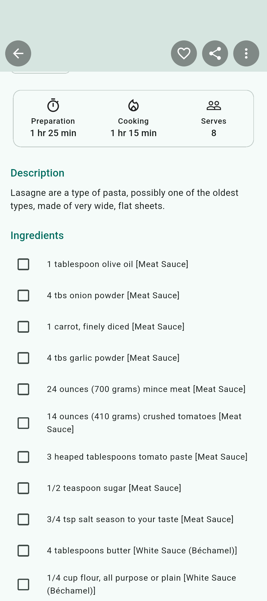
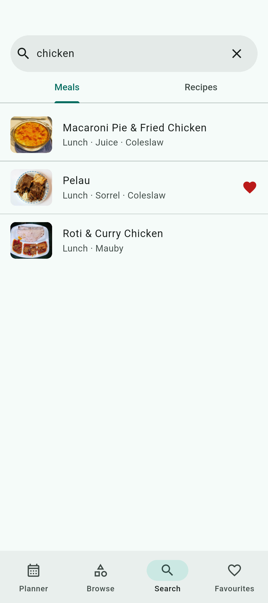
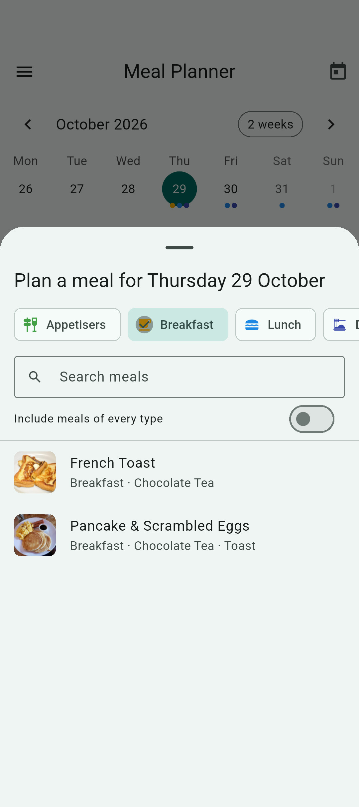
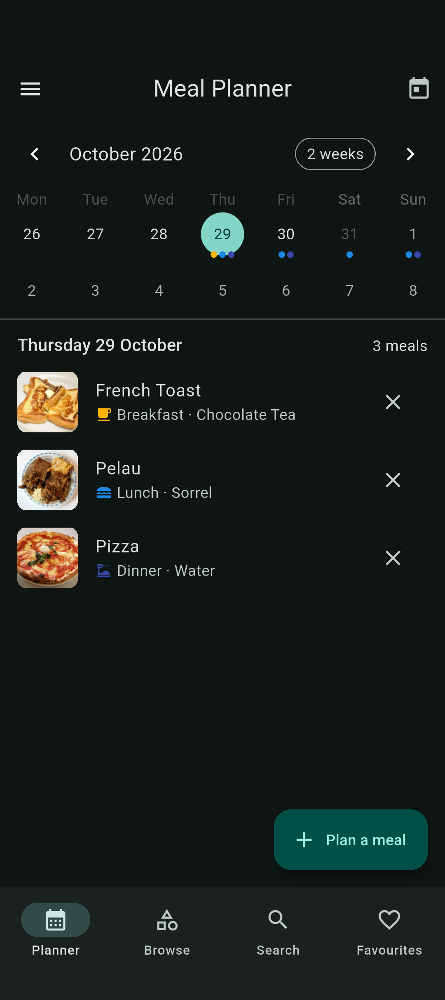

# YumMealPrep

A free and open-source (FOSS) meal planner and digital recipe book. Plan what you will eat each
day, keep your meals and recipes in one place, and share them as PDFs. Everything stays on your
device and works offline: no accounts, adverts or tracking.


[](https://buymeacoffee.com/asptechinc)

## Features

- **Meal Planner**: a calendar (month, two-week or week view) of planned meals. Plan as many meals
  a day as you like, in breakfast, lunch, dinner, appetiser, dessert and smoothie slots, and
  swipe one away to remove it, with undo.
- **Browse**: meals and recipes by category, with a count for each.
- **Search**: find meals and recipes by name, description, ingredient, drink or side dish. Accents
  and "&" versus "and" don't matter.
- **Favourites**: the meals and recipes you love, one tap away.
- **Meals** with a drink, side dishes and photos of their nutrition labels.
- **Recipes** with ingredients to tick off while cooking, numbered steps, and times and servings.
- **Add your own** with the Add meal and Add recipe buttons. Only a name is required; leaving a
  form with unsaved changes asks first.
- **Pictures are optional.** Items without one show a "no picture" placeholder. Pictures you add
  are resized, saved without their metadata (such as where they were taken) and stored once even
  if several items use them.
- **Share or print** any meal or recipe as a PDF, made on the device.
- **Import and export** everything, pictures included, as a single
  [documented, editable `.backup` file](docs/backup-format.md) (plain JSON), for example to move
  to a new phone. You can also [write one by hand](#writing-a-backup-by-hand).
- A few sample meals and recipes to show how it works, light, dark and system themes, and credits
  for every photo.

## Privacy

Your data is stored in a local database on your device and is never sent anywhere. The Android app
does not even request the internet permission. See the [privacy policy](PRIVACY_POLICY.md).

## Screenshots

| Planner | Browse | Meal | Recipe |
| :---: | :---: | :---: | :---: |
|  |  |  |  |

| Search | Plan a meal | Dark theme |
| :---: | :---: | :---: |
|  |  |  |

## Getting started

You need the [Flutter SDK](https://docs.flutter.dev/get-started/install) (stable channel). No
accounts, API keys or `.env` file are required.

```bash
git clone https://github.com/ASPTechInc/YumMealPrep.git
cd YumMealPrep
flutter pub get
flutter run            # on a connected phone or emulator
flutter run -d linux   # or as a desktop app
flutter test           # unit and widget tests
```

YumMealPrep runs on Android, iOS, Linux, macOS, Windows and the web.

End-to-end tests run the real app on a phone or emulator:

```bash
flutter test integration_test/app_test.dart -d <device>
```

The store screenshots are taken by an integration test, on a phone emulator:

```bash
flutter drive --driver=test_driver/integration_test.dart \
    --target=integration_test/screenshots_test.dart -d <device>
```

## Writing a backup by hand

A `.backup` file is plain JSON in the [documented format](docs/backup-format.md). The app works
offline and never downloads pictures, so to give items pictures, list a file path (or a web
address) as the `image` and let `scripts/pack-backup.py` embed them:

```json
{"meals": {"curry-goat": {"name": "Curry Goat", "type": "dinner", "image": "photos/curry-goat.jpg"}}}
```

```bash
scripts/pack-backup.py my-meals.json   # writes yummealprep-backup-<date>-<time>.backup
```

Then use **Import data** in the app. A picture that cannot be read shows the "no picture"
placeholder.

## Built with

- [Flutter](https://flutter.dev/) and Material 3
- [sembast](https://pub.dev/packages/sembast), a pure-Dart local database
- [table_calendar](https://pub.dev/packages/table_calendar) for the planner
- [pdf](https://pub.dev/packages/pdf) and [printing](https://pub.dev/packages/printing) for sharing
- [image](https://pub.dev/packages/image) to resize added pictures and remove their metadata
- [Noto Sans](https://fonts.google.com/noto/specimen/Noto+Sans) (SIL Open Font License) in PDFs

## Contributing

Contributions are welcome. Please read [CONTRIBUTING.md](CONTRIBUTING.md) and the
[Code of Conduct](CODE_OF_CONDUCT.md). Ideas for future versions are in the
[roadmap](docs/roadmap.md), and security issues should be reported as described in
[SECURITY.md](SECURITY.md).

## Licence

YumMealPrep is released under the [MIT licence](LICENSE). Bundled fonts are under the SIL Open
Font License 1.1, and the food photos are from Wikimedia Commons under CC0, public domain, CC BY or
CC BY-SA licences, credited in [assets/images/CREDITS.md](assets/images/CREDITS.md). Licensing for
every file is recorded with [REUSE](https://reuse.software/) in [REUSE.toml](REUSE.toml).

## Developer

- [ASPTechnologies Incorporation](https://github.com/ASPTechInc)

See also [other FOSS projects](docs/foss-projects.md) by the developer.
